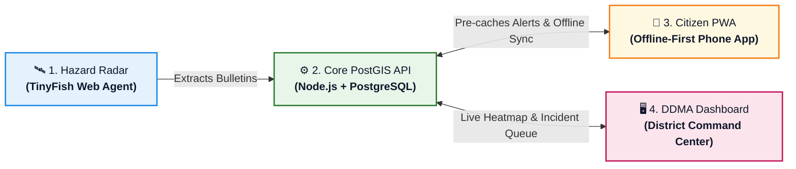
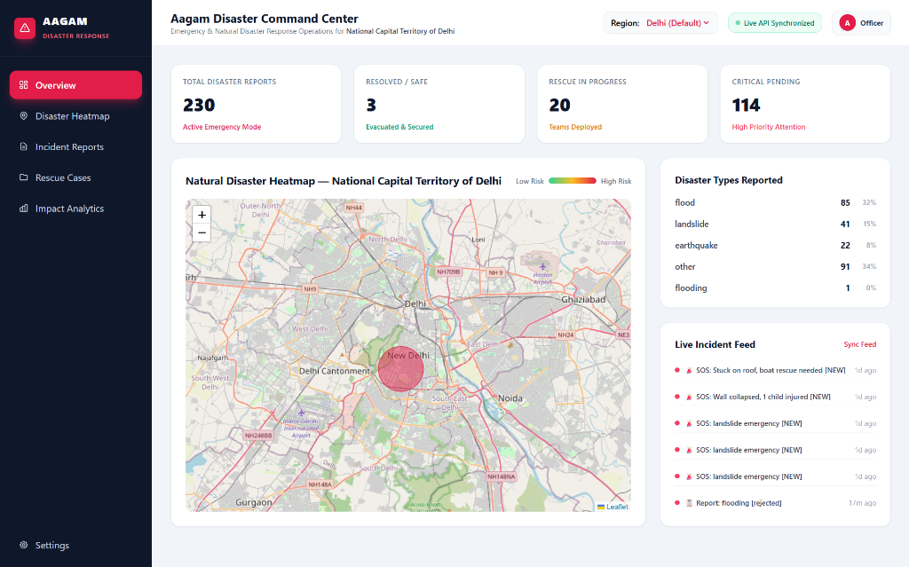
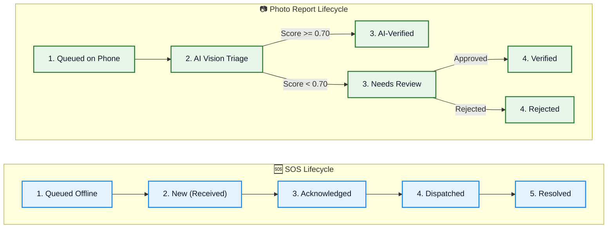

<h1 align="center">🛡️ AAGAM (आगम)</h1>

<p align="center">
  <strong>Autonomous Alert Gathering & Action Management</strong><br>
  <em>AI-Powered Multi-Hazard Intelligence & Offline-First Emergency Response Platform</em>
</p>

<p align="center">
  <a href="https://github.com/COOKEE-MJ/AAGAM_">
    
  </a>
  <a href="LICENSE">
    
  </a>
  <a href="https://nodejs.org/">
    
  </a>
  <a href="https://postgis.net/">
    
  </a>
  <a href="https://web.dev/progressive-web-apps/">
    
  </a>
  <a href="https://tinyfish.io/">
    
  </a>
</p>

<p align="center">
  
  
  
  
  
</p>

<p align="center">
  <a href="#-quickstart-in-5-commands">⚡ Quickstart</a> •
  <a href="#-aagam-in-one-minute">📖 1-Minute Overview</a> •
  <a href="#-system-architecture">🏗️ Architecture</a> •
  <a href="#-screen-by-screen-walkthrough">📱 Screens</a> •
  <a href="#-the-offline-sync-engine">📶 Offline Sync</a> •
  <a href="#-the-contributors">👥 Contributors</a>
</p>

---

<p align="center">
  
</p>

> ### 📸 **[IMAGE PLACEHOLDER: HERO SHOWCASE BANNER]**
> - **File:** `docs/screenshots/hero-banner.png` (1200 × 600 px)
> - **Content:** High-res split mockup. **Left:** Citizen Mobile PWA in emergency dark mode showing *"Offline SOS Queued"* with safe route to nearest shelter. **Right:** DDMA Authority Command Dashboard on desktop showing live PostGIS density heatmap of East Delhi.

---

## 📖 AAGAM in One Minute

**AAGAM** warns people about impending disasters, guides them to open shelters even when the internet is completely down, and gives district administration verified on-the-ground intelligence to direct rescue teams.



### 👥 The Two Users of AAGAM

| Dimension | 📱 Citizen (Resident / Evacuee) | 🖥️ Authority Officer (DDMA / DEOC) |
|---|---|---|
| **Who** | Any resident of a vulnerable district | District Disaster Management Authority staff |
| **Device** | Smartphone browser (Zero-install PWA) | Laptop or desktop browser |
| **Account** | Instant setup: Name, Phone, Home District *(OTP mocked)* | Admin-seeded account tied to district (`authority` JWT role) |
| **Main Goal** | Know danger level, find safe shelter, trigger SOS | Monitor district heatmap, verify damage, dispatch NDRF |
| **Cost** | **Always Free** for every citizen | Subscribed by District Administration |

---

## ⚖️ Five Golden Product Rules

| # | Rule | Core Principle & Technical Guarantee |
|:---:|---|---|
| **1** | **Prepare First, Connect Second** | Alerts, shelter lists, and map tiles are cached locally while online so they remain 100% accessible with zero cellular signal. |
| **2** | **Nothing Disappears Silently** | Every SOS and photo report displays a transparent status: `Queued` ➔ `Sent` ➔ `Acknowledged` ➔ `Dispatched` ➔ `Resolved`. |
| **3** | **AI Assists, Humans Decide** | Computer vision triage flags high-confidence damage ($\ge 0.70$). District officers retain full authority to approve or reject. |
| **4** | **Every Alert Proves Its Source** | Every warning displays official publication timestamps and direct links back to IMD, CWC, or NDMA source bulletins. |
| **5** | **Strict Privacy by Role** | Citizens never see other citizens' phone numbers or SOS coordinates. Officers only access data within their assigned district. |

---

## 🏗️ System Architecture

Data originates from authoritative government sources, passes through **TinyFish Web Agents**, normalizes into the **PostGIS** database, and syncs across citizen and command applications.


---

## 📱 Screen-by-Screen Walkthrough

### 1. Citizen PWA (Mobile Phone)

<p align="center">
  
</p>

> ### 📸 **[IMAGE PLACEHOLDER: CITIZEN PWA SCREENSHOTS]**
> - **File:** `docs/screenshots/citizen-offline-sos.png` (800 × 500 px)
> - **Content:** Mobile screenshot in Airplane Mode: Amber banner *"Offline: Updated 14:02"*, center red SOS button, and *"Nearest Open Shelter: Thyagaraj Stadium (0.8 km)"*.

| Tab | Key UI Elements | Works Offline? |
|---|---|:---:|
| 🏠 **Home** | Status strip (*"Online"* / *"Offline"*), hazard alert cards with severity colors (Red/Orange/Yellow), *What To Do* checklist, *View Official Source* link. | **YES** |
| 🗺️ **Map** | GPS blue dot, shelter pins, danger zone polygon, **"Nearest Open Shelter"** button that draws a dashed cached route. | **YES** |
| 🆘 **SOS** | Big Red Button (hold 2s), status progress card (*Queued $\rightarrow$ Sent $\rightarrow$ Acknowledged $\rightarrow$ Dispatched*), *"I'm Safe / Cancel"* button, 112 dialer. | **YES** *(Queued)* |
| 📷 **Report** | Hazard category chips, camera capture (~300 KB), draggable location pin, note input, *My Reports* status tracker. | **YES** *(Queued)* |
| 👤 **Profile** | Home district selector, emergency phone number, **"Download Offline Area"** button, manual sync button. | **YES** |

---

### 2. Authority Command Dashboard (Desktop Laptop)

<p align="center">
  
</p>

> ### 📸 **[IMAGE PLACEHOLDER: AUTHORITY COMMAND DASHBOARD]**
> - **File:** `docs/screenshots/authority-dashboard.png` (1200 × 650 px)
> - **Content:** DEOC command screen: Left navigation menu, live PostGIS incident density heatmap of Delhi NCR, active SOS cards, and live shelter occupancy meters.

| Page | What the Officer Sees & Does |
|---|---|
| 🗺️ **Overview** | KPI tiles (*Active Alerts*, *Open SOS*, *Reports to Review*, *Shelter Capacity*), real-time PostGIS heatmap, time filter (1h, 6h, 24h), SOS cluster markers ($\ge 3$ within 500m). |
| 📢 **Alerts** | Bulletin management table: Approve & Publish pending alerts, edit alert message, withdraw expired alerts, view source link. |
| 🚨 **SOS Queue** | Chronological distress list: Inspect citizen contact, team assignment input, one-click **Acknowledge**, **Dispatch**, and **Resolve**. |
| 📸 **Reports** | Three triage tabs: **Needs Review**, **AI-Verified**, and **Rejected**. View photo, AI confidence bar, and verify or reject with reason. |
| 🏕️ **Shelters** | Shelter list + map: Capacity vs occupancy, quick `+ / -` occupancy toggles, Open/Closed switch. |

---

## 🏕️ Shelter Pin & Heatmap Logic

### Shelter Pin Colors
- 🟢 **Green (Open):** Space available ($< 80\%$ occupied).
- 🟡 **Amber (Filling):** High occupancy ($80\% - 99\%$).
- 🔴 **Red (Full):** $100\%$ capacity reached (PWA automatically diverts routing to next closest shelter).
- ⚪ **Grey (Closed):** Decommissioned or unsafe shelter.

### Heatmap Color Scale (Command Center Only)
- 🟡 **Yellow:** Low incident density (1–3 trusted reports).
- 🟠 **Orange:** Moderate incident density.
- 🔴 **Red:** Critical trouble spot — **direct rescue units here first**.

> 🔒 **Why Citizens Do Not See the Heatmap:** Showing raw distress clusters publicly could cause mass panic and compromises citizen privacy. Citizens receive clean, verified alert polygons and shelter paths.

---

## 📶 The Offline Sync Engine

How AAGAM ensures zero distress calls are dropped when mobile towers fail:

| Feature | Offline Availability | Technical Implementation |
|---|:---:|---|
| **Open Citizen App** | ✅ **YES** | Service Worker serves cached application shell. |
| **Read Active Alerts** | ✅ **YES** | Read from local storage with *"Last updated"* timestamp. |
| **View Shelter Map & Pins** | ✅ **YES** | Pre-cached for user's home district at setup. |
| **Route to Shelter** | ✅ **YES** | Pre-calculated straight/cached line to nearest open facility. |
| **GPS Geolocation** | ✅ **YES** | Hardware GPS operates independently of cellular data. |
| **Trigger SOS** | ✅ **YES** | Saved to **IndexedDB** with client UUID; auto-syncs on network return. |
| **Submit Damage Photo** | ✅ **YES** | Compressed locally and queued for batch upload. |
| **Receive NEW Alerts** | ⚠️ *Requires Signal* | Real-time push requires data connection; SMS fallback simulated. |

---

## 🔄 Status Life Cycles



---

## ⚡ Quickstart in 5 Commands

Run the full AAGAM backend, database migrations, and 11-hazard seed dataset locally:

```bash
# 1. Clone the repository
git clone https://github.com/COOKEE-MJ/AAGAM_.git
cd AAGAM_

# 2. Configure environment from safe template
cp .env.example .env

# 3. Install dependencies
npm install

# 4. Initialize PostGIS schema & load demo dataset
npm run db:init && npm run db:seed

# 5. Start development API server (Port 3000)
npm run dev
```

### Verify Everything Works (Automated Smoke Suite)
```bash
npm run smoke
```
*(Executes 23 automated end-to-end checks across PostGIS spatial queries, SOS idempotency, and role permissions).*

### 🔑 Pre-Configured Demo Credentials (Password: `Demo@1234`)
- 👮 **Authority Officer:** `9000000001` *(Full access to Heatmap, Verification Queue, & Shelters)*
- 👤 **Citizen Account:** `9000000002` *(PWA access, SOS trigger, and Photo Reports)*

---

## 🛡️ Security & Privacy Audit

| Security Item | Status | Guarantee |
|---|:---:|---|
| **Database & API Passwords** | 🔒 **PROTECTED** | Local `.env` is listed in `.gitignore` and has **NEVER** been committed to git history. |
| **Citizen PII** | 🔒 **ENCRYPTED** | Phone numbers and exact coordinates are accessible exclusively by authorized district officers. |
| **Role-Based Access (RBAC)** | 🔒 **ENFORCED** | Public users and citizens receive `403 Forbidden` if attempting to query command heatmaps or queues. |
| **Idempotency Safeguard** | 🔒 **VERIFIED** | Every SOS carries a unique `clientId`; duplicate network packets never trigger duplicate alerts. |

---

## 👥 The Contributors

<table align="center">
  <tr>
    <td align="center" width="25%">
      <br />
      <sub><b>Diya Bhatt</b></sub><br />
      <sub>🎨 <b>Frontend & UI Lead</b></sub><br />
      <small>React PWA • Service Worker • IndexedDB • Leaflet Maps</small>
    </td>
    <td align="center" width="25%">
      <br />
      <sub><b>Nidhi Jha</b></sub><br />
      <sub>⚙️ <b>Backend & Database Lead</b></sub><br />
      <small>Node.js Express API • PostgreSQL / PostGIS • Spatial Queries • Offline Sync Engine</small>
    </td>
    <td align="center" width="25%">
      <br />
      <sub><b>Aarushi Mathur</b></sub><br />
      <sub>🤖 <b>AI & GIS Specialist</b></sub><br />
      <small>TinyFish Web Agent • Vision Triage • Bulletin Extractor</small>
    </td>
    <td align="center" width="25%">
      <br />
      <sub><b>Mansi</b></sub><br />
      <sub>⚙️ <b>Backend Lead & Product Lead</b></sub><br />
      <small>PostGIS Spatial Architecture • Idempotent Offline Sync • Product Strategy & PRD • E2E QA Testing • Delivery</small>
    </td>
  </tr>
</table>

---

## ⚖️ Hackathon Transparency Disclosure
- **Pretrained AI Model:** Image damage verification utilizes a pretrained vision model with a default confidence threshold of $0.70$.
- **Simulated Telecom Gateway:** In the demonstration environment, SMS notifications are logged to a spatial database table (`sms_log`) rather than sending paid telecom SMS.
- **Seeded Demo Data:** Demonstration shelters and alerts are geolocated in the New Delhi district for testing.

---

<p align="center">
  <strong>⭐ Star this Repo!! ⭐</strong><br>
  <sub>Built with ❤️ for resilient disaster management across India • Licensed under MIT</sub>
</p>
