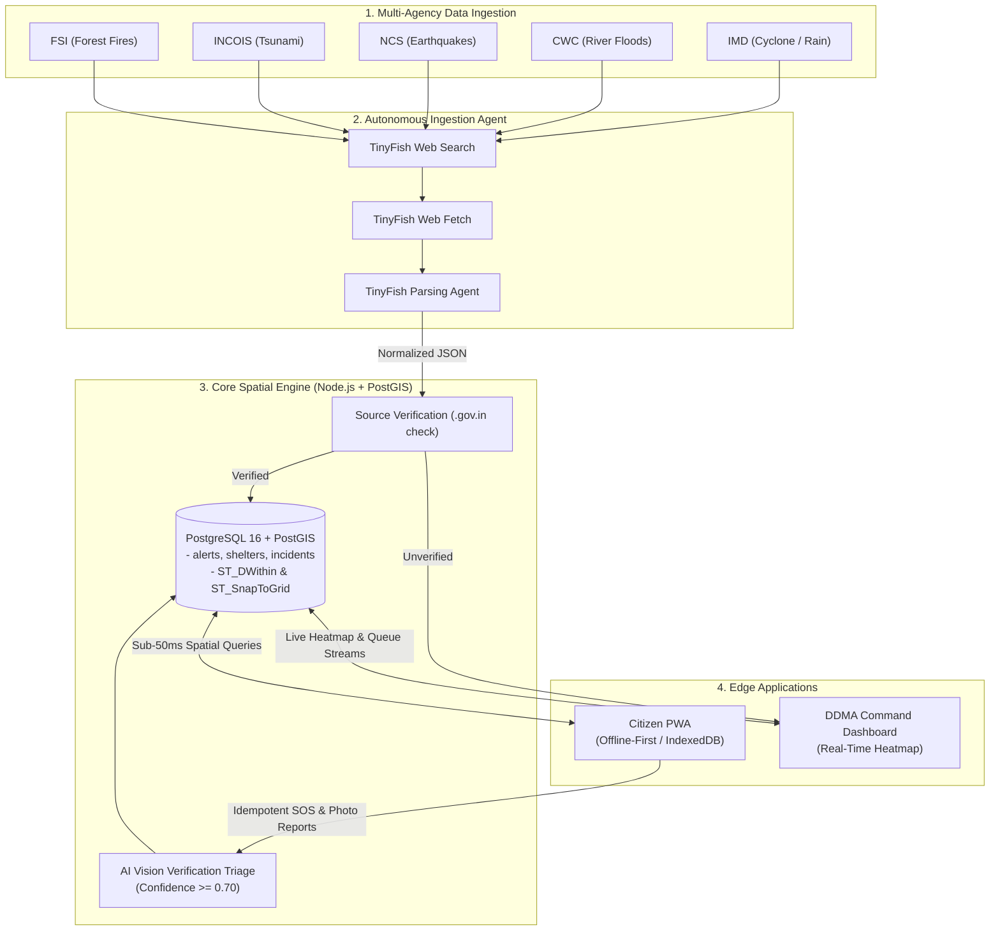
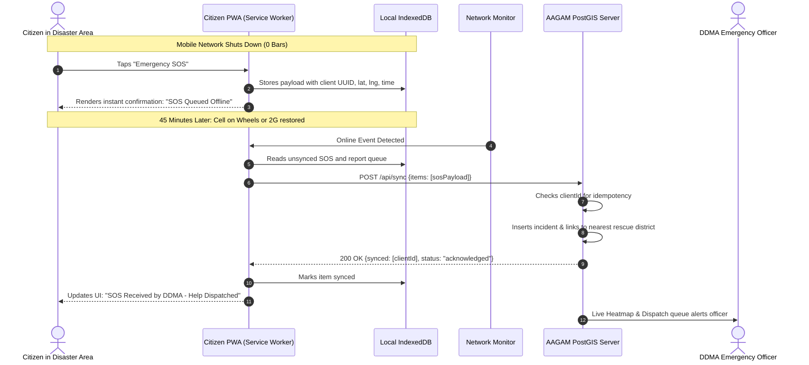
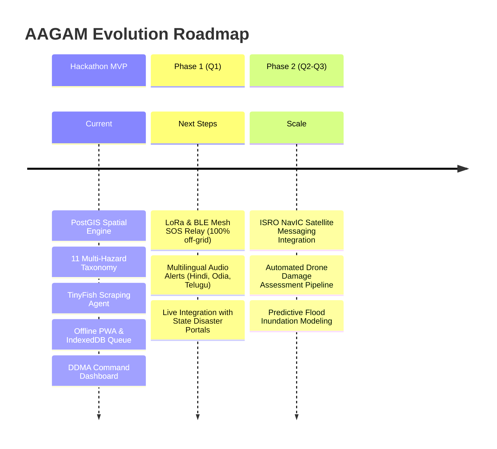

# AAGAM (आगम) 🛡️
### AI-Powered Multi-Hazard Intelligence & Offline-First Disaster Response System

[](https://opensource.org/licenses/MIT)
[](https://nodejs.org/)
[](https://postgis.net/)
[](https://web.dev/progressive-web-apps/)
[](https://tinyfish.io/)
[](file:///tests/)

> **Autonomous Alert Gathering & Action Management (AAGAM)** is a next-generation disaster management platform that bridges citizen survival and district administration. Powered by autonomous web agents, offline-first progressive web tech, and multimodal AI verification, AAGAM ensures critical alerts reach every citizen—even when power grids and cellular towers collapse.

---

## ⚡ Quick Links & Demo

- 🎥 **Watch the 2-Minute Demo Video:** [DEMO_VIDEO_URL]
- 🌐 **Live Citizen PWA App:** `[CITIZEN_APP_URL]` *(or run locally below)*
- 🖥️ **Live Authority Command Dashboard:** `[DASHBOARD_URL]` *(or run locally below)*
- 📑 **Slide Deck & Architecture Docs:** [`docs/`](docs/)

---

```
========================================================================================
[ADD IMAGE HERE: Hero Banner / Product Showcase Mockup]
Type: High-resolution side-by-side product mockup.
Left: Citizen Mobile PWA in emergency dark mode showing "Offline SOS Queued" and "Safe Route to Thyagaraj Shelter".
Right: DDMA Authority Command Dashboard on desktop showing live PostGIS heatmap of East Delhi, incident pins, and dispatch buttons.
File path to place image: docs/screenshots/hero-banner.png
========================================================================================
```


---

## 💡 Key Highlights in 4 Lines

1. **Multi-Hazard Autonomous Radar:** Uses **TinyFish Web Agents** to continuously scrape, parse, and geocode live bulletins across **11 distinct Indian disaster types** from official portals (IMD, CWC, NCS, INCOIS, FSI, NDMA).
2. **True Offline-First Resilience:** Zero-install Progressive Web App (PWA) caches district maps, safe shelter routes, and emergency guidance; locally queues encrypted SOS signals in **IndexedDB** for seamless auto-sync upon reconnection.
3. **Multimodal AI Verification:** Computer vision pipeline triages crowd-sourced disaster photos in real-time ($\ge 0.70$ confidence), eliminating hoaxes and spam before they reach district incident dispatchers.
4. **Actionable Command Center:** Real-time spatial dashboard for District Disaster Management Authorities (DDMA) with PostGIS grid heatmaps, dynamic shelter occupancy tracking, and one-click field team dispatch.

> **Sustainable Business Model:** *"Free for citizens. Paid by districts and enterprise supply chains."*

---

## 🛑 The Problem: The Reality of Disasters in India

India's geographical diversity exposes over **85% of its landmass to multiple natural hazards**. In high-stress catastrophe scenarios, existing response systems break down due to three fatal bottlenecks:

```
========================================================================================
[ADD IMAGE HERE: Infographic - Disaster Bottlenecks in India]
Type: 3-column infographic illustrating: (1) Broken Telecom Towers during floods, (2) Confused citizens checking multiple govt websites, (3) Fake WhatsApp forwards causing panic.
File path to place image: docs/screenshots/problem-infographic.png
========================================================================================
```


1. **Scattered Alert Silos:** Warnings are fractured across different portals—IMD for weather, CWC for river levels, NCS for tremors, and local police handles. Citizens are forced to navigate 5+ uncoordinated apps.
2. **Network Blackouts When Needed Most:** Floods, cyclones, and landslides routinely destroy mobile towers and power grids. Traditional native apps crash or render blank screens when there is no internet connection.
3. **Unverified Noise & Panic:** Control rooms are swamped with unverified social media forwards, duplicate distress calls, and outdated messages, delaying life-saving NDRF/SDRF deployments.
4. **Massive Socio-Economic Losses:** Floods alone account for **~63% of natural disaster damages** in India, with **over 93% of losses uninsured**, devastating vulnerable rural and urban populations.

---

## 🚀 The AAGAM Solution

AAGAM solves this crisis with a unified, bi-directional, resilient architecture:

```
========================================================================================
[ADD IMAGE HERE: Solution Overview Diagram]
Type: Clean architectural split showing: Left: Citizen Mobile App (offline-first, zero install, SOS) <---> Center: Secure PostGIS & AI Ingestion Engine <---> Right: District Emergency Operations Center (DEOC) Command Screen.
File path to place image: docs/screenshots/solution-overview.png
========================================================================================
```


### 1. Citizen Survival App (PWA)
- **Zero-Install Instant Access:** Works instantly in any mobile browser on low-end smartphones without app store downloads.
- **Offline Cache:** Automatically pre-caches shelter locations, evacuation checklists, offline emergency contacts, and evacuation routes into local browser storage.
- **One-Tap Resilient SOS:** Generates an idempotent, cryptographically tagged distress signal with GPS coordinates. If offline, it saves to `IndexedDB` and triggers auto-sync the millisecond cellular, Wi-Fi, or SMS connectivity is detected.

```
========================================================================================
[ADD IMAGE HERE: Citizen App Screenshot - Offline Emergency Mode]
Type: Mobile screenshot of Citizen App with airplane mode ON.
Showing: Amber warning banner "No Internet - Emergency Cache Active", with green "Find Nearest Safe Shelter (1.2 km)" button and one-tap red SOS button.
File path to place image: docs/screenshots/citizen-offline-sos.png
========================================================================================
```


### 2. Authority Command Dashboard (DDMA)
- **Spatial Incident Heatmap:** Aggregates real-time SOS requests and verified crowd reports using PostGIS spatial clustering to expose high-density danger zones.
- **Dynamic Shelter Management:** Real-time occupancy meters with automatic status transitions:
  - `Open`: Capacity under 80%
  - `Filling Fast`: Capacity between 80% and 99%
  - `Full`: 100% capacity (system automatically diverts routing to the next closest facility).
- **Incident Queue & Team Dispatch:** Triage incoming citizen photo reports, inspect AI confidence scores, acknowledge distress calls, and dispatch rescue teams with live status updates.

```
========================================================================================
[ADD IMAGE HERE: Authority Command Center Dashboard]
Type: Desktop widescreen view of the District Emergency Operations Center (DEOC).
Showing: Interactive dark map of Delhi NCR with PostGIS density clusters, active SOS cards on right sidebar, and live shelter status gauges.
File path to place image: docs/screenshots/authority-dashboard.png
========================================================================================
```


---

## 🤖 TinyFish Web Agent & AI Integration

AAGAM integrates the **TinyFish Autonomous Web Agent Suite** to bridge the gap between government data portals and front-line citizens:

```
========================================================================================
[ADD IMAGE HERE: TinyFish AI Pipeline Flowchart]
Type: Diagram showing TinyFish Web Agent reading IMD/CWC sites, extracting unstructured tables/bulletins, converting to GeoJSON alerts, and pushing to AAGAM PostGIS database.
File path to place image: docs/screenshots/tinyfish-pipeline.png
========================================================================================
```


- 🔍 **TinyFish Web Search:** Autonomously discovers freshly published bulletins and warning bulletins across regional state disaster portals and meteorological stations.
- 📥 **TinyFish Web Fetch:** Navigates complex government HTML structures, PDFs, and sensor pages to extract tabular hydrological metrics, reservoir levels, and cyclonic coordinates.
- 🧠 **TinyFish Agent API:** Converts unstructured Hindi/English warning bulletins into standardized, machine-readable JSON payloads containing ISO 8601 timestamps, severity levels (Warning, Watch, Advisory), affected district boundaries, and hazard taxonomy codes.
- 🛡️ **Automated Authority Verification Rule:**
  - Alerts originating from verified government domains (`.gov.in` and `.nic.in`) are automatically verified and published.
  - Bulletins from secondary feeds are routed into a `pending` state for human officer approval with one-click verification.

### Multimodal Photo Verification
When citizens submit on-the-ground damage reports (submerged roads, downed trees, broken bridges), AAGAM's AI Vision pipeline evaluates the image:
- **Confidence $\ge 0.70$:** Automatically promoted to `ai_verified`, immediately lighting up on the district commander's heatmap.
- **Confidence $< 0.70$:** Routed to the `needs_review` queue to prevent hoax calls and spam from cluttering emergency response queues.

```
========================================================================================
[ADD IMAGE HERE: AI Verification Triage Example]
Type: Visual side-by-side card.
Left: Citizen photo of urban flood with bounding box labeled "severe_flood (Confidence: 0.92)" -> Green Badge "AI VERIFIED".
Right: Random meme/unrelated photo submitted -> Orange Badge "NEEDS OFFICER REVIEW".
File path to place image: docs/screenshots/ai-verification-triage.png
========================================================================================
```


---

## 🏛️ Comprehensive Multi-Hazard Coverage

AAGAM does not focus on just one hazard. It implements a unified data model covering **11 official hazard categories** recognized by the National Disaster Management Authority (NDMA):

| Hazard Type | Official Indian Source | Monitoring Frequency | Key Ingested Metrics |
|---|---|---|---|
| **Cyclone** | India Meteorological Department (IMD) | Every 3 hours | Wind speed, landfall coordinates, central pressure |
| **Riverine / Flash Flood** | Central Water Commission (CWC) | Hourly | Gauge reading, warning level, trend (rising/falling) |
| **Heavy Rainfall / Cloudburst** | IMD Doppler Radar Network | Real-time (15 min) | Precipitation intensity (mm/hr), cloud top height |
| **Lightning / Thunderstorm** | Damini App / IMD Lightning Network | Real-time | Strike count, strike azimuth, cloud-to-ground flash rate |
| **Tsunami** | INCOIS (Indian National Centre for Ocean Info) | Real-time | Seismic epicenter, ocean depth, arrival time forecast |
| **Earthquake** | National Center for Seismology (NCS) | Real-time | Richter magnitude, hypocenter depth, epicentral coords |
| **Landslide** | Geological Survey of India (GSI) | Daily / Monsoon | Soil moisture index, slope stability warning level |
| **Heatwave** | IMD / NDMA Heat Action Plan | Daily forecast | Wet-bulb temperature, heat index, consecutive hot days |
| **Cold Wave** | IMD Regional Centers | Daily forecast | Minimum temperature departures, ground frost warnings |
| **Forest Fire** | Forest Survey of India (FSI - Van Agni) | Satellite pass (SNPP/VIIRS) | Thermal anomaly coordinates, fire intensity index |
| **Drought** | Mahalanobis Crop Forecast Centre (MNCFC) | Weekly / Bi-weekly | Soil Moisture Anomaly, Normalized Difference Veg Index |

---

## 🏗️ Technical Architecture & Data Pipeline

AAGAM is engineered with high-performance, open standards designed for resilience and sub-second spatial queries.

### Ingestion, Triage & Response Flow



---

### The Offline Synchronization Loop

How AAGAM guarantees zero dropped distress signals during network collapse:



---

## 📊 Innovation & Competitive Matrix: SACHET vs AAGAM

| Capability | NDMA SACHET (Current System) | AAGAM (Our Innovation) |
|---|---|---|
| **Offline Operability** | ❌ Fails completely without active data connection | ✅ **Full offline operation** via Service Workers & IndexedDB |
| **Hazard Ingestion** | ⚠️ Manual notification pushes & CAP broadcasts | ✅ **Autonomous TinyFish Agents** scraping 11 hazard feeds 24/7 |
| **Citizen Feedback** | ❌ One-way broadcast; citizens cannot reply | ✅ **Bi-directional crowdsourcing** with photo reports |
| **False Report Filtering** | ❌ Requires manual phone calls to verify | ✅ **Multimodal AI triage** ($\ge 0.70$ confidence filter) |
| **Shelter Intelligence** | ⚠️ Static addresses in PDF or simple lists | ✅ **Real-time capacity tracking** with auto-status diversion |
| **Network Resilience** | ❌ Single drop causes request failure | ✅ **Idempotent retry engine** with deterministic UUID keys |
| **Deployment Barrier** | ⚠️ Heavy native app download (15–40 MB) | ✅ **Zero-install instant PWA** (< 500 KB cached) |
| **Actionable Dashboard** | ⚠️ Disconnected municipal computer tools | ✅ **Unified PostGIS Command Center** with live spatial heatmaps |

---

## 🌪️ 5-Step Disaster Simulation Walkthrough

To experience AAGAM's end-to-end resilience, consider the following simulated disaster scenario:

```
========================================================================================
[ADD IMAGE HERE: 5-Step Simulation Flow Visual]
Type: Step-by-step visual horizontal sequence showing: (1) IMD Cyclone Alert -> (2) Pre-caching in PWA -> (3) Tower breakdown & Offline SOS -> (4) Network restoration & Auto-sync -> (5) DDMA Rescue Dispatch.
File path to place image: docs/screenshots/timeline-steps.png
========================================================================================
```


1. **$T - 12\text{ Hours}$ (Early Warning):** TinyFish Radar scrapes an IMD Bulletin predicting severe cyclonic storm landfall. AAGAM generates a high-severity spatial alert for 3 coastal districts.
2. **$T - 6\text{ Hours}$ (Proactive Pre-Caching):** Citizens opening the PWA automatically download and cache safe evacuation routes, emergency instructions, and the nearest 8 relief shelters.
3. **$T - 0\text{ Hours}$ (Cellular Blackout):** As the storm makes landfall, telecommunication towers and power fail. A trapped citizen triggers the SOS button. The PWA writes the encrypted distress packet into IndexedDB.
4. **$T + 45\text{ Mins}$ (Transient Connection):** Emergency responders deploy an ad-hoc 2G cell tower. The PWA's network monitor detects connectivity and fires a background batch sync (`POST /api/sync`).
5. **$T + 50\text{ Mins}$ (Triage & Rescue Dispatch):** The incident appears instantly on the DDMA Command Heatmap with exact GPS coordinates. The officer clicks **Dispatch Team**, assigning NDRF Unit 4.

---

## 💰 Business Model & Financial Sustainability

AAGAM is built on a sustainable, high-impact public-private model:

```
========================================================================================
[ADD IMAGE HERE: Business & Revenue Model Canvas]
Type: Financial infograph illustrating B2G District Model, B2B Enterprise Risk API, and TAM/SAM/SOM breakdown.
File path to place image: docs/screenshots/revenue-model.png
========================================================================================
```


### Revenue Streams
- 🏛️ **B2G (District Administration SaaS):** ₹6 Lakh / district / year for DDMA command center licensing, real-time spatial analytics, and multi-agency operational integration.
- 🏢 **B2B (Enterprise Hazard Risk API):** ₹50,000 to ₹2,00,000 / month for insurance providers, supply chain logistics (e.g., Delhivery, Blue Dart), and infrastructure operators requiring automated hazard boundary feeds.
- 🤝 **Humanitarian & NGO Access:** Free tier for accredited relief organizations, community volunteer networks, and civil defence personnel.

### Market Opportunity (India)
- **TAM (Total Addressable Market):** **₹1,200 Cr** (766 Indian districts, Smart Cities Mission, nationwide logistics & infrastructure risk management).
- **SAM (Serviceable Addressable Market):** **₹380 Cr** (Top 250 disaster-vulnerable coastal, riverine, and seismic zone districts + top commercial enterprises).
- **SOM (Serviceable Obtainable Market):** **₹45 Cr** (Initial 3-year phased deployment across 40 priority districts in Odisha, Andhra Pradesh, Gujarat, and Assam).

---

## 💻 Local Setup & Quickstart (5 Commands)

Get the complete AAGAM backend and database running locally in under 3 minutes:

```bash
# 1. Clone repository & enter workspace
git clone https://github.com/COOKEE-MJ/AAGAM_.git
cd AAGAM_

# 2. Copy environment configuration
cp .env.example .env

# 3. Install dependencies
npm install

# 4. Initialize schema & load demonstration seed data (New Delhi)
npm run db:init
npm run db:seed

# 5. Start API server on Port 3000
npm run dev
```

### Run Automated Smoke & Unit Tests
To verify all PostGIS endpoints, idempotency guarantees, and AI verification flows:
```bash
npm run smoke
```
*(Expect: 23 passed, 0 failed)*

### Pre-Configured Demo Credentials (Password: `Demo@1234`)
- 👮 **DDMA Emergency Officer:** `9000000001` *(Access to Command Heatmap, Verification Queue & Shelter Controls)*
- 👤 **Citizen Demo Account:** `9000000002` *(Access to PWA, SOS, and Hazard Alerts)*

---

## 🔮 Future Roadmap



---

## 👥 The Team

| Name | Role | Core Lane & Deliverables |
|---|---|---|
| **Member 1** | **Frontend & Citizen Experience** | Offline PWA, Service Workers, IndexedDB Sync Queue, DDMA React Dashboard |
| **Member 2** | **Backend & Database** | Node.js Express API, PostgreSQL/PostGIS Schema, Spatial Queries, Idempotency |
| **Member 3** | **AI & Data Pipeline** | TinyFish Web Ingestion Agent, Multimodal Vision Verification, Hazard Extraction |
| **Member 4** | **Product, Delivery & QA** | Architecture & Deck, End-to-End Testing, Documentation, API Governance |

---

## ⚖️ Transparency Note for Evaluators

In accordance with hackathon guidelines, here is a transparent breakdown of the current evaluation build:
- **Live & Production-Ready:** PostgreSQL + PostGIS spatial schema, spatial distance queries, idempotent SOS queuing, multi-item offline sync endpoint, JWT role guards, and automated test suite.
- **Demonstration / Simulation:** SMS alerts are logged to an internal spatial table (`sms_log`) rather than sending live paid telecom SMS. The AI photo verification defaults to mock mode (`AI_MODE=mock`, 85% confidence score) for deterministic offline judging demonstrations.

---

<div align="center">
  <sub>Built with ❤️ for resilient, life-saving disaster intelligence across India.</sub><br>
  <sub>Licensed under the <a href="LICENSE">MIT License</a>.</sub>
</div>
